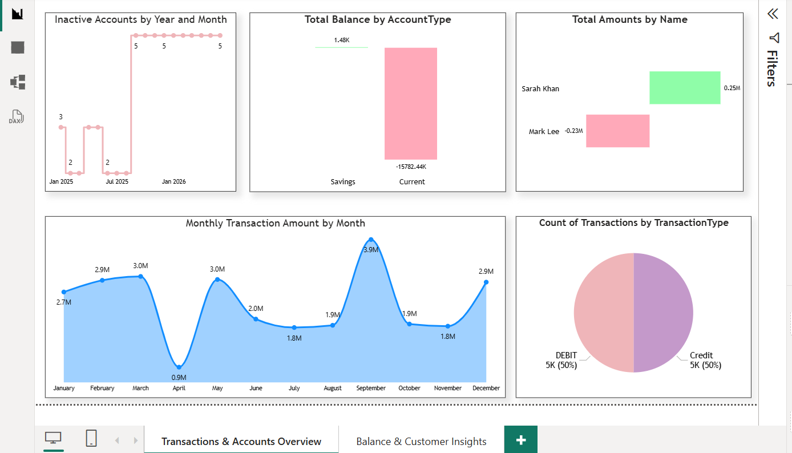
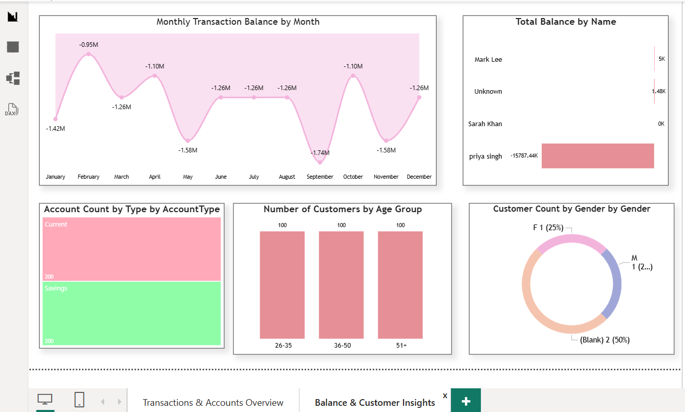

# 🏦 Banking Analytics Dashboard | SQL Server Management Studio + Excel + Power BI

An end-to-end banking data analytics project. The data was created, cleaned and joined using SQL queries written in **SQL Server Management Studio (SSMS)**, reviewed in **Excel**, and visualised through a **2-page interactive dashboard in Power BI Desktop**.

---

## 📌 Project Overview

The project analyses banking data from three related tables: **Customers**, **Accounts** and **Transactions**. The dashboard gives insights into transaction trends, account balances, inactive accounts and customer demographics.

## 🛠️ Tools & Technologies

| Tool | Purpose |
|------|---------|
| **SQL Server Management Studio (SSMS)** | Writing SQL queries for data creation, cleaning and joining tables |
| **Excel** | Data review and storage (CSV / XLSX) |
| **Power BI Desktop** | Data modelling, DAX measures and dashboard visuals |
| **DAX** | Calculated columns (Customer Age, Customer Age Group) and measures |

## 🔄 Project Workflow

1. **Data creation** – Created the banking tables and inserted data using SQL in SSMS.
2. **Data cleaning** – Wrote SQL queries in SSMS to fix inconsistencies in the date column and other date columns.
3. **Data integration** – Combined Customers, Accounts and Transactions using SQL Joins in SSMS.
4. **Data review** – Checked and stored the final data in Excel / CSV.
5. **Load into Power BI** – Connected Power BI Desktop to SQL Server and loaded the combined data.
6. **DAX** – Created calculated columns (Customer Age, Customer Age Group) and measures.
7. **Dashboard design** – Built and formatted visuals across two report pages.

## 🗃️ Dataset

The final table, **CombinedBankingDataset**, is created by joining the Customers, Accounts and Transactions tables. It contains **21 columns**:

| Category | Columns |
|----------|---------|
| Customer | CustomerID, Name, Gender, DateOfBirth, Email, Phone, Address |
| Account | Account_AccountID, Account_CustomerID, AccountType, Balance, Currency, OpenDate |
| Transaction | TransactionID, Transaction_AccountID, TransactionDate, TransactionType, Amount, Description |
| Calculated (DAX) | Customer Age, Customer Age Group |

## 📊 Dashboard

### Page 1 – Transactions & Accounts Overview

| Visual | Chart Type | What it shows |
|--------|-----------|---------------|
| Inactive Accounts by Year and Month | Step line chart | Accounts that became inactive from Jan 2025 to Jan 2026 |
| Total Balance by AccountType | Column chart | Balance comparison between Savings and Current accounts |
| Total Amounts by Name | Bar chart | Net transaction amount per customer |
| Monthly Transaction Amount by Month | Area chart | Month-wise transaction amount (highest in September, lowest in April) |
| Count of Transactions by TransactionType | Pie chart | Split between Debit and Credit transactions (50% / 50%) |

### Page 2 – Balance & Customer Insights

| Visual | Chart Type | What it shows |
|--------|-----------|---------------|
| Monthly Transaction Balance by Month | Area chart | Month-wise transaction balance trend |
| Total Balance by Name | Bar chart | Balance per customer |
| Account Count by AccountType | Tree map | Number of Current and Savings accounts |
| Number of Customers by Age Group | Column chart | Customers in the 26–35, 36–50 and 51+ age groups |
| Customer Count by Gender | Donut chart | Gender-wise customer distribution |

## 💡 Key Insights

- Debit and Credit transactions are evenly split (50% each).
- Monthly transaction amount is highest in **September (3.9M)** and lowest in **April (0.9M)**.
- Savings accounts show a positive total balance, while Current accounts show a negative total balance.
- Between 2 and 5 accounts became inactive in the months tracked from January 2025 to January 2026.
- The dataset has an equal number of Savings and Current accounts (200 each) and equal customers across the 26–35, 36–50 and 51+ age groups (100 each).
- Some customers have a missing gender value, which can be cleaned further.

## 🧹 Data Cleaning Highlights

- Fixed inconsistent date formats using SQL
- Standardised all date columns
- Verified data types before loading into Power BI
- Combined three tables into a single clean dataset using joins

## 🗂️ Repository Structure

```
Banking-Analytics-PowerBI/
├── Banking spreadsheet.xlsx   # Final dataset (Excel)
├── Banking.pbix                # Power BI dashboard file
├── Dashboard_Page1.png         # Dashboard screenshot - Page 1
├── Dashboard_Page2.png         # Dashboard screenshot - Page 2
├── Lec+1+SQL+Query.txt         # SQL queries (SSMS) - Part 1
├── Lec+2+SQL+Query.txt         # SQL queries (SSMS) - Part 2
├── Lec+3.txt                   # SQL queries (SSMS) - Part 3
└── README.md
```

## 🚀 How to Run

1. Clone the repository
   ```bash
   git clone https://github.com/pujakumarimgr239-glitch/Banking-Analytics-PowerBI.git
   ```
2. Open **SQL Server Management Studio (SSMS)**, connect to your SQL Server instance and run the SQL queries from the `.txt` files in order (Lec 1 → Lec 2 → Lec 3).
3. Open `Banking.pbix` in **Power BI Desktop**.
4. Update the data source (server and database name) if needed, then click **Refresh**.
5. The final dataset is also available in the Excel file for quick viewing.

## 📷 Screenshots

**Page 1 – Transactions & Accounts Overview**



**Page 2 – Balance & Customer Insights**



## 📚 Key Learnings

- Writing SQL queries and joins across multiple tables in SSMS
- Cleaning and standardising date data
- Connecting SQL Server with Power BI
- Creating DAX calculated columns and measures
- Choosing the right chart for each question (area, pie, donut, tree map, bar and step line charts)
- Designing a multi-page dashboard

## 👩‍💻 Author
     Puja Kumari
- GitHub: https://github.com/pujakumarimgr239-glitch

---

⭐ If you found this project helpful, please give it a star!
